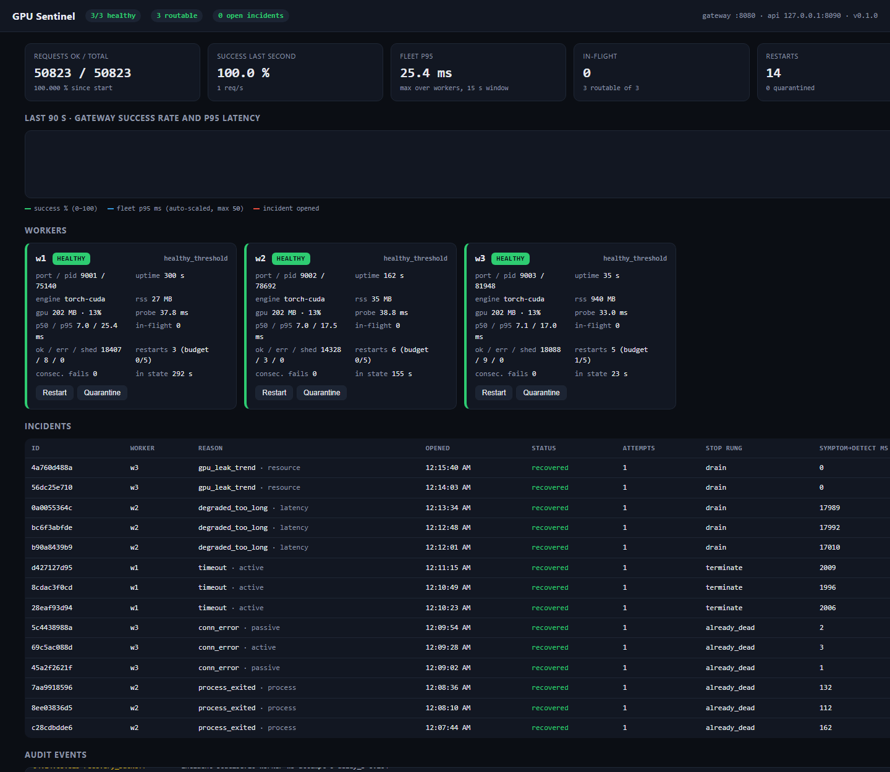

# GPU Sentinel

[](https://github.com/FahadNafeesAhmed/GPU-Sentinel/actions/workflows/ci.yml)


**A self-healing supervisor for inference workers.** It probes a fleet of model-serving
processes, detects crashes, hangs, latency degradation and memory leaks, routes traffic
around the sick worker within milliseconds, restarts it with jittered exponential backoff
under a restart budget, and writes every decision to an append-only audit log.
Everything below is measured by the repository's own fault-injection benchmark.

```
                 ┌──────────────────────── controller (one process) ─────────────────────────┐
  clients ──►    │  gateway :8080  ──► least-in-flight routing, retry-on-other-worker        │
  POST /infer    │        │  passive signals (conn errors, timeouts, 5xx, in-flight age)       │
                 │        ▼                                                                   │
                 │  supervisor ── tick: liveness · HTTP /health · RSS/GPU limits · leak trend  │
                 │        │             · fleet-relative p95 · stuck requests  → state machine │
                 │        │  exit watcher: process/container exit → immediate verdict          │
                 │        ▼                                                                   │
                 │  recovery ── backoff(full jitter) → drain → SIGTERM → SIGKILL → restart     │
                 │        │     restart budget → QUARANTINE                                     │
                 │        ▼                                                                   │
                 │  audit log (JSONL) · Prometheus /metrics · dashboard + JSON API :8090       │
                 └──────┬──────────────────────┬──────────────────────┬────────────────────────┘
                        ▼                      ▼                      ▼
                   worker w1 :9001        worker w2 :9002        worker w3 :9003
               (numpy CPU engine, or torch on CUDA; /health /ready /infer /metrics /chaos)
```



<!-- RESULTS:BEGIN -->
## Measured results

Full report: [`bench/results/latest-cpu.md`](bench/results/latest-cpu.md) (raw JSON and the
complete incident log for the run are next to it). CPU engine, 3 workers, 100 req/s open-loop
load, 5 repeats per fault, on a Ryzen laptop running Windows 11.

| What happened | Detected | Out of routing | Service restored | Requests failed |
|---|---:|---:|---:|---:|
| Worker killed with `SIGKILL` | **20 ms** | 11 ms | **1.7 s** | 0 of 855 in window |
| Worker crashed from inside (`exit 139`) | 59 ms | 55 ms | 1.9 s | 0 of 999 |
| Event loop wedged (no HTTP, not even `/health`) | 3.2 s | 1.2 s | 6.1 s | 0 of 3,083 |
| Worker became slow (+800 ms per request) | 24.2 s (policy) | **8.2 s** | 25.9 s | 0 of 12,917 |
| Memory leak (RSS trend) | 10.2 s | 10.2 s | 11.9 s | 0 of 5,958 |
| Out of memory (hard RSS limit) | 0.96 s | 0.96 s | 3.2 s | 0 of 1,742 |

- **0 failed requests out of 110,000** sent during 30 fault injections: every attempt that hit a
  dying worker was retried on a healthy peer inside the request deadline.
- **0 false positives**: 60 s / 6,000 requests / 1,212 probe ticks on a healthy fleet opened no
  incident and produced no single-probe `SUSPECT` transition.
- **Crash loop handled as designed**: five restarts with growing full-jitter backoff
  (0.46 → 0.81 → 0.73 → 0.12 → 3.54 s slept), then quarantine on the sixth kill.
- **Healthy peers were never flagged** while one worker was slow: the detector compares a
  worker against the fleet median, not an absolute threshold alone.
- **Capacity of this synthetic CPU workload**: 400 req/s at p99 66 ms; at 800 req/s the fleet
  saturates and the workers shed load with `503` instead of timing out silently.

Medians over 5 repeats; the tables below carry the min–max ranges. "Detected" for the slow
worker is the policy's 15 s recycle timer plus the time to accumulate 20 samples; the number
that matters operationally is "out of routing", when the gateway stopped sending it work.

<details>
<summary><b>Full benchmark report (CPU engine)</b></summary>

- **Engine**: `cpu` · **workers**: 3 × concurrency 4 · **load**: 100.0 req/s open-loop, 16 tokens/request
- **Host**: Windows-10-10.0.26300-SP0 · AMD64 Family 25 Model 97 Stepping 2, AuthenticAMD (32 logical CPUs) · GPU: NVIDIA GeForce RTX 5060 Laptop GPU, 8151 MiB, 596.13 · Python 3.11.9
- **Policy**: probe every 1.0 s (timeout 1.0 s), 3 consecutive failures → unhealthy, 2 passes → healthy, startup probe 0.2 s; backoff base 0.5 s cap 30.0 s (full jitter); budget 5/300.0 s
- **Repeats per fault**: 5 · total wall time 1296 s

### Fault injection (timings measured from the injection timestamp)

| Scenario | n | Detect (ms) | Removed from routing (ms) | Service restored (ms) | Stop rung | Requests in fault window | Failed | Success in window | Retried OK |
|---|---:|---:|---:|---:|---|---:|---:|---:|---:|
| crash_sigkill (`process_exited`) | 5 | 20 (17-25) | 11 (9-13) | 1747 (1456-1948) | already_dead | 178 (146-197) | 0 (0-0) | 100.00 % | 1 (0-1) |
| crash_internal (`process_exited`) | 5 | 59 (55-65) | 55 (50-61) | 1922 (1835-2326) | already_dead | 195 (184-236) | 0 (0-0) | 100.00 % | 1 (0-2) |
| hang (`timeout`) | 5 | 3226 (3207-3278) | 1236 (1204-1282) | 6116 (5751-6693) | terminate | 614 (574-669) | 0 (0-0) | 100.00 % | 3 (2-4) |
| slow (`degraded_too_long`) | 5 | 24217 (23222-24238) | 8226 (7223-8254) | 25858 (24882-26692) | drain | 2590 (2492-2671) | 0 (0-0) | 100.00 % | 0 (0-0) |
| leak (`rss_leak_trend`) | 5 | 10176 (9210-10193) | 10176 (9211-10193) | 11885 (10938-12557) | drain | 1192 (1094-1258) | 0 (0-0) | 100.00 % | 0 (0-0) |
| oom (`rss_limit`) | 5 | 959 (908-2281) | 959 (907-2007) | 3197 (2899-4837) | drain | 323 (292-483) | 0 (0-0) | 100.00 % | 0 (0-0) |

*Detect* = incident opened. *Removed from routing* = first transition out of HEALTHY (suspect/degraded/unhealthy), after which the gateway stops sending new requests to the worker. *Service restored* = replacement worker passed its readiness checks and is routable again. Ranges are min–max over repeats; the headline figure is the median.

| Scenario | p50 before fault | p99 before fault | p50 in window | p99 in window | p99 after recovery | Total failed / total requests |
|---|---:|---:|---:|---:|---:|---:|
| crash_sigkill | 9.8 ms (9.4-13.6) | 50.6 ms (43.5-59.3) | 9.7 ms (9.2-14.8) | 83.8 ms (47.8-153.7) | 55.1 ms (47.4-384.1) | 0 / 12500 |
| crash_internal | 12.8 ms (12.6-13.8) | 53.7 ms (50.6-132.6) | 14.9 ms (13.9-16.4) | 62.5 ms (54.5-77.8) | 56.2 ms (52.5-79.5) | 0 / 12500 |
| hang | 13.1 ms (12.5-13.5) | 53.9 ms (51.2-74.8) | 15.9 ms (12.4-18.3) | 55.4 ms (53.0-59.7) | 54.0 ms (52.2-57.0) | 0 / 12500 |
| slow | 13.2 ms (12.8-13.4) | 53.4 ms (51.0-77.4) | 17.8 ms (17.1-18.3) | 75.4 ms (63.4-131.4) | 54.4 ms (52.4-56.0) | 0 / 22500 |
| leak | 12.9 ms (12.6-13.6) | 53.0 ms (49.8-79.2) | 18.9 ms (17.9-20.9) | 72.1 ms (62.3-117.5) | 52.9 ms (51.6-58.3) | 0 / 37500 |
| oom | 12.8 ms (12.5-13.8) | 70.2 ms (51.7-227.6) | 20.0 ms (19.8-20.9) | 90.9 ms (50.7-462.3) | 55.3 ms (48.3-56.0) | 0 / 12500 |

### Crash loop (same worker killed again after every recovery; budget 5 restarts / 300 s)

| Kill # | Backoff slept (s) | Detect (ms) | Service restored (ms) | Outcome |
|---:|---:|---:|---:|---|
| 1 | 0.459 | 17.8 | 1938.5 | recovered |
| 2 | 0.806 | 16.3 | 2281.7 | recovered |
| 3 | 0.732 | 17.1 | 2199.5 | recovered |
| 4 | 0.117 | 17.0 | 1584.5 | recovered |
| 5 | 3.539 | 16.2 | 4994.3 | recovered |
| 6 | None | 15.3 | — | quarantined |

Final state: `quarantined`. Backoff is full-jitter, so slept time is a uniform sample from a doubling envelope, not a smooth curve.

### False positives (healthy fleet under load)

- 60 s at 99.9 req/s achieved (6000 requests, 100.0 % success, p50 12.3 ms, p99 48.91 ms)
- **Incidents opened: 0** · suspect transitions (single failed probe): 0 · degraded transitions: 0 · probe ticks: 1212

### Latency vs load (15 s per level, healthy fleet)

| Target req/s | Achieved | Success | p50 ms | p95 ms | p99 ms | max ms | Shed (503) |
|---:|---:|---:|---:|---:|---:|---:|---:|
| 50 | 50.1 | 100.0 % | 11.16 | 14.71 | 48.6 | 57.72 | 0 |
| 100 | 100.0 | 100.0 % | 11.55 | 20.2 | 53.12 | 90.33 | 0 |
| 200 | 199.5 | 100.0 % | 12.55 | 28.55 | 56.55 | 91.56 | 0 |
| 400 | 398.4 | 100.0 % | 15.77 | 35.72 | 65.77 | 84.69 | 0 |
| 800 | 699.1 | 51.683 % | 530.81 | 2468.31 | 4635.21 | 6003.06 | 67 |

</details>

_CUDA results: see the section below once `bench/results/latest-torch.md` exists._
<!-- RESULTS:END -->

## Why these numbers are credible

- **Each repeat starts from a clean policy state** (backoff attempt counter and restart
  budget reset after the fleet settles), so the fault tables measure the first-restart path.
  The crash-loop table measures the opposite: the same worker killed again after every
  recovery, with the backoff and budget left to do their job.
- **Timings are measured from the injector's clock**, not the controller's. The benchmark
  records the wall time at which it sends `SIGKILL` (or the chaos command) and compares it
  with the incident's `opened_at` / `recovered_at`. The controller cannot flatter itself.
- **Load is open-loop** (fixed arrival rate, like real users). A failed or slow request does
  not reduce the arrival rate, so "requests failed during the fault" is a real availability
  number, not an artefact of clients backing off.
- **Every repeat is reported as median (min–max)** across 5 runs; the raw JSON for every run,
  including the full incident log, is committed under `bench/results/`.
- **False positives are measured, not assumed**: a 60 s healthy run under the same load
  counts incidents opened and single-probe "suspect" transitions.
- The benchmark is part of CI (`--quick` mode) and the numbers above are reproducible with
  one command: `make bench`.

## What it detects and how it reacts

| Failure | Signal | Reaction |
|---|---|---|
| Process crash / container exit | exit watcher (event-driven) + liveness poll | immediate `UNHEALTHY`, restart after jittered backoff |
| Wedged event loop (no HTTP at all) | 3 consecutive probe timeouts (hysteresis) | restart; `/drain` cannot answer, so the ladder escalates to `SIGTERM`/`SIGKILL` and records which rung worked |
| Slow worker (throttled GPU, contention) | gateway-observed p95 > max(400 ms, 3 × peer median) for 3 ticks | `DEGRADED`: removed from routing immediately, recycled if not better in 15 s |
| Request stuck in flight | in-flight age > 8 s | counts as a failed probe |
| Memory leak (RSS or GPU) | least-squares slope over a 45 s window > 60 MB/min | proactive recycle **before** the hard limit |
| Out of memory | RSS or GPU memory above the configured limit | immediate recycle |
| Worker returns 5xx / connection errors | passive checks from the gateway | count toward the same failure streak as active probes |
| Crash loop | more than 5 restarts in 300 s | `QUARANTINED` (no more restarts, operator alerted via API/dashboard) |
| Slow model load | startup grace period, probes every 0.2 s while `STARTING` | probe failures during startup do **not** count; only the grace timeout does |

State machine (per worker, pure Python, 100 % unit-tested):

```
STARTING ──2 passes──► HEALTHY ──1 fail──► SUSPECT ──1 pass──► HEALTHY
                          │                   └──3rd consecutive fail──► UNHEALTHY
                          ├──3 slow ticks──► DEGRADED ──15 s──► UNHEALTHY
                          └──FATAL (exit / limit / leak)──────► UNHEALTHY
UNHEALTHY ► RECOVERING ─backoff, stop, start─► STARTING        RECOVERING ─budget exhausted─► QUARANTINED
```

## Design decisions

- **Hysteresis is the false-positive control.** One dropped probe makes a worker `SUSPECT`
  (logged, no action); three in a row trigger recovery; two passes are required before a
  restarted worker takes traffic. Passive gateway signals feed the same streak, so a dead
  worker is usually ejected by its first failed request, well before the next probe.
- **Event-driven crash detection.** A watcher task awaits process exit (`Popen.wait` in a
  thread, or `docker wait` for containers), so a `SIGKILL` is seen in tens of milliseconds
  instead of up to one probe interval later. The per-tick liveness poll remains as a backstop.
- **Fleet-relative latency.** A worker is degraded only if its p95 is high *relative to its
  peers* and above an absolute floor. Fleet-wide load makes everyone slow together and must
  not trip every worker at once. At least 20 samples are required, so a single GC pause or
  cold-cache request cannot flag a worker (p95 of 20 is the second-largest sample).
- **Drained workers keep their verdict.** Once a `DEGRADED` worker is out of rotation it
  stops producing latency samples; the detector holds the verdict instead of letting the
  worker flap back to `HEALTHY` on missing evidence. The exit is a recycle (or
  `route_to_degraded = true` to keep a trickle of traffic flowing to it).
- **Capped exponential backoff with full jitter** (the AWS Architecture Blog recipe):
  `sleep = U(0, min(cap, base·2^n))`. The attempt counter resets after 60 s of stability.
- **Restart budget → quarantine.** A worker that needs more than 5 restarts in 5 minutes is
  quarantined rather than restarted forever: crash-looping only adds load and hides the root
  cause. An operator releases it with one API call.
- **Escalated stop.** `/drain` (finish in-flight work, exit 0) → `SIGTERM` → `SIGKILL`, each
  with its own grace period; the incident records which rung worked, so "workers that only
  die to SIGKILL" is a query over the audit log.
- **Load shedding is not failure.** A worker that answers `503 overloaded` is retried on a
  peer but not penalised; only connection errors, timeouts and `5xx` count against health.
- **One audit log, two consumers.** Every transition, backoff decision, stop rung and restart
  is one JSON line in `data/incidents.jsonl` (and in a ring buffer for the API/dashboard),
  with `symptom_to_detect_ms` and `detect_to_recover_ms` on every incident.

## Quick start

```bash
pip install -e ".[dev]"            # Python 3.11+, deps: aiohttp, psutil, numpy
python -m sentinel controller --config config/sentinel.toml --log-format text
```

That launches three CPU workers and the controller. Open the dashboard at
<http://127.0.0.1:8090/>, then break things:

```bash
curl -X POST localhost:8080/infer -d '{"tokens":32}'               # through the gateway
curl -X POST localhost:9002/chaos/crash                              # w2 segfaults
curl -X POST localhost:9001/chaos/hang                               # w1 wedges its event loop
curl -X POST localhost:9003/chaos/slow -d '{"ms":800}'               # w3 gets slow
curl -X POST localhost:9003/chaos/leak -d '{"mb_per_request":4}'     # w3 leaks memory
curl -X POST localhost:9001/chaos/oom                                # w1 allocates past its limit
curl -s localhost:8090/api/incidents | python -m json.tool           # what Sentinel did about it
curl -s localhost:8090/metrics | grep sentinel_                      # Prometheus exposition
```

Operator actions: `POST /api/workers/{id}/restart | quarantine | unquarantine`.

### Docker Compose

```bash
docker compose up --build -d       # 3 worker containers + controller, gateway :8080, dashboard :8090
docker kill sentinel-w2            # the controller sees the exit event and `docker start`s it
bash scripts/compose_smoke.sh      # the same check, scripted (also runs in CI)
```

Workers run with `restart: "no"` on purpose: recovery is Sentinel's decision, with backoff
and a budget, not the daemon's. The controller talks to sibling containers through the
mounted Docker socket (the same pattern as `autoheal`).

### GPU workers

```bash
pip install torch nvidia-ml-py      # any CUDA build of torch
python -m sentinel controller --set workers.engine=torch --set limits.gpu_mem_mb=6000
python -m sentinel bench --engine torch --set limits.gpu_mem_mb=6000
```

The torch engine runs the same tanh-matmul chain in fp16 on CUDA and reports
`torch.cuda.memory_reserved()`; NVML adds device utilisation and temperature. Nothing
requires a GPU: the CPU engine runs the identical control plane.

## Configuration

Everything lives in one TOML file; any key can be overridden with
`SENTINEL_<SECTION>__<KEY>=value` or `--set section.key=value`. The knobs that matter:

| Key | Default | Meaning |
|---|---|---|
| `probe.interval_s` / `timeout_s` | 1.0 / 1.0 | active `/health` cadence and hard timeout |
| `probe.unhealthy_threshold` / `healthy_threshold` | 3 / 2 | consecutive failures to act; consecutive passes to trust |
| `probe.startup_grace_s` / `startup_interval_s` | 15 / 0.2 | time a (re)started worker may take; probe cadence while starting |
| `latency.p95_abs_ms` / `p95_fleet_ratio` / `min_samples` | 400 / 3.0 / 20 | degradation = p95 > max(abs, ratio × peer median), given enough samples |
| `latency.recycle_degraded_after_s` | 15 | how long a drained worker gets before it is recycled |
| `limits.rss_mb` / `gpu_mem_mb` | 1536 / off | hard limits (immediate recycle) |
| `limits.leak_slope_mb_per_min` / `leak_window_s` | 60 / 45 | proactive recycle on sustained growth |
| `recovery.backoff_base_s` / `backoff_cap_s` / `jitter` | 0.5 / 30 / full | restart backoff |
| `recovery.max_restarts` / `restart_window_s` | 5 / 300 | restart budget before quarantine |
| `recovery.drain_grace_s` / `term_grace_s` | 2 / 3 | escalation ladder timings |
| `gateway.max_retries` / `request_timeout_s` | 2 / 5 | retry a failed attempt on a different worker within the deadline |
| `workers.backend` / `engine` / `count` | subprocess / cpu / 3 | `docker` backend for Compose; `torch` engine for CUDA |

## Tests

```bash
make test        # ruff + mypy + 61 unit tests + 14 fault-injection integration tests
```

Unit tests cover the state machine (every transition and threshold), the detectors (fleet
comparison, min-sample gate, trend slope, limits), backoff envelopes, the restart budget,
the escalation ladder against a scripted backend, config precedence/validation, the
Prometheus renderer and the audit log. Integration tests start a real controller with real
worker processes on free ports and assert on observed behaviour:

| Test | Asserts |
|---|---|
| external `SIGKILL` | incident opened < 1.5 s, exactly one restart, new pid, event sequence opened → backoff → restarted → closed |
| in-process crash (`exit 3`) | exit code captured in the audit log |
| kill under load | ≥ 99.5 % of requests succeed while a worker is dead (measured: 100 %) |
| wedged event loop | detected by probe timeouts within 4 s; stop ladder escalates past `/drain` |
| slow worker | `DEGRADED` with p95 > threshold, healthy peers untouched, recycled with reason `degraded_too_long` |
| stuck requests | `stuck_request` verdict fires while `/health` still answers |
| memory leak | `rss_leak_trend` fires far below the hard limit |
| hard RSS limit | immediate, `symptom_to_detect_ms == 0` |
| 12 concurrent clients for 5 s | zero incidents, zero suspects, zero restarts |
| crash loop | quarantined after the budget; operator release resets it |
| slow model load | startup probe failures are not counted; only the grace timeout fires |
| operator restart | graceful `drain` rung |
| no routable workers | gateway answers `503` with `X-Sentinel-Attempts: 0` |

CI (GitHub Actions) runs lint, types, both suites on Ubuntu (3.11, 3.12) and Windows, a
quick benchmark, and the Docker Compose kill-and-heal smoke test.

## Benchmark methodology

`python -m sentinel bench` starts the controller in-process, warms up, then for each fault:
settle (all healthy + 1 s) → start open-loop load at 100 req/s → inject at t = 5 s → wait for
the incident to close → report. Columns:

- **Detect**: injection → incident opened (state `UNHEALTHY`, recovery scheduled).
- **Removed from routing**: injection → first transition out of `HEALTHY`
  (`SUSPECT`/`DEGRADED`/`UNHEALTHY`), after which the gateway sends no new work to the worker.
- **Service restored**: injection → replacement worker passed two readiness probes and is
  routable again. Includes backoff, the stop ladder, Python/engine start-up and probes.
- **Fault window**: requests sent between injection and restoration; *failed* counts anything
  that was not `200` after the gateway's retries.

Re-run with `make bench` (≈15 min) or `make bench-quick` (≈4 min, 1 repeat).

## Limitations

- One controller; it is not itself replicated (a crashed controller leaves workers running
  but unsupervised). Running two controllers against one fleet needs leader election.
- Backends: local subprocesses and Docker containers. No Kubernetes backend (there, a
  readiness probe + `restartPolicy` covers the simple cases; the detectors here are what you
  would still want in a sidecar).
- Latency detection needs traffic: at least 20 gateway-observed requests in the window.
  A slow worker that receives little traffic is caught by the probe path only if `/health`
  itself slows down.
- One tick probes all workers concurrently and waits for the slowest (bounded by the probe
  timeout), so a hung worker stretches the tick to `timeout_s` for everyone.
- On Windows `terminate()` and `kill()` are both `TerminateProcess`, so the ladder's
  `SIGTERM` rung behaves like `SIGKILL` there. Per-process GPU memory via NVML is not
  available under WDDM; the torch engine's own accounting is used instead.
- The CPU "inference" is a synthetic matmul chain. The control plane does not care, but
  absolute latencies in the sweep describe this workload on this laptop, nothing else.

## Repository layout

```
sentinel/
  config.py              typed TOML config, env/CLI overrides, validation
  logging_setup.py       structured JSON/text logging
  metrics.py             dependency-free Prometheus text exposition
  worker/                inference service: engine.py (numpy / torch), chaos.py, resources.py, app.py
  controller/
    state.py             per-worker state machine (pure)
    detector.py          fleet-relative latency, leak trend, resource limits (pure)
    recovery.py          backoff, restart budget, escalated stop (pure + async)
    backends.py          SubprocessBackend, DockerBackend
    health.py            HTTP prober
    supervisor.py        tick loop, exit watchers, incidents, recovery tasks
    gateway.py           routing, retries, passive health signals
    incidents.py         JSONL audit log + ring buffer
    api.py, dashboard.html, main.py
bench/                   open-loop load, fault scenarios, Markdown report
tests/unit, tests/integration
config/                  sentinel.toml (local), sentinel.docker.toml (compose)
docker/, docker-compose.yml, scripts/compose_smoke.sh, .github/workflows/ci.yml
```

MIT licensed.
